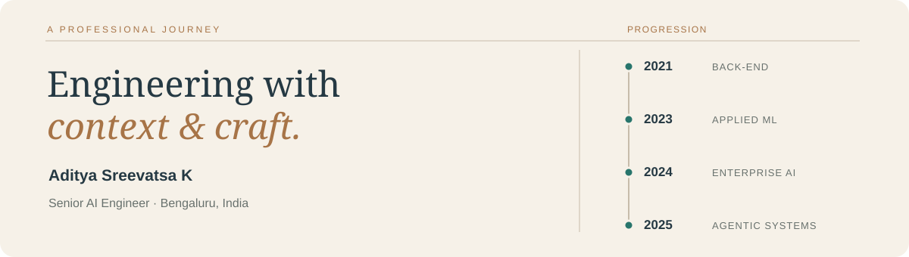

  <picture>
    <source media="(prefers-color-scheme: dark)" srcset="assets/atlas-dark.svg">
    <source media="(prefers-color-scheme: light)" srcset="assets/atlas-light.svg">
    
  </picture>

  <a href="https://www.linkedin.com/in/adityasreevatsak/">Professional profile</a> ·
  <a href="https://github.com/AdityaSreevatsaK?tab=repositories">Engineering work</a> ·
  <a href="mailto:krishnan.adityasreevatsa@gmail.com">Get in touch</a>

## About me

I'm a **Senior AI Engineer** with experience across **enterprise AI, machine learning, back-end services and technical delivery**. I build systems that connect business problems to dependable engineering, particularly multi-agent workflows, retrieval, structured-data interfaces and evaluation.

My professional path has taken me from banking microservices to real-time ML, enterprise knowledge systems and, now, agentic analytics. Alongside client delivery, I build reusable public tools and contribute improvements upstream.

## A career built through engineering

| Period | Role | Engineering work |
| :-- | :-- | :-- |
| **2025 to present** | **Senior AI Engineer · Enterprise AI** | Architecture and delivery of multi-agent AI solutions, evaluation approaches, analytics interfaces, Text-to-SQL and API services. Collaboration with client stakeholders and engineering teams. |
| **2024 to 2025** | **Associate Consultant · Infosys** | ML engineering, NLP-to-Cypher over knowledge graphs, Java/Spring Boot services, and cross-functional enterprise delivery. |
| **2023 to 2024** | **Software Engineer · Ernst & Young** | Streaming data pipelines, fraud-oriented ML analytics, data extraction and feature engineering. |
| **2021 to 2023** | **Software Engineering Analyst · Accenture** | Production microservices, back-end APIs, software reliability and Agile delivery in enterprise banking. |

These descriptions are intentionally client-safe: they reflect the type of work and responsibility, rather than confidential system details or client-specific results.

## Selected engineering projects

### 01 · [Agentic Engineering Toolkit](https://github.com/AdityaSreevatsaK/agentic-engineering-toolkit)

A local-first scaffolder for Python agent applications, intended to reduce repetitive setup work and establish consistent project foundations. Supports templates built with LangGraph, AWS Strands and LlamaIndex, offline mock paths and optional provider integrations. **Prototype status, not a production deployment.**

### 02 · [Agent Engineering Accelerator](https://github.com/AdityaSreevatsaK/agent-engineering-accelerator)

An evolving evaluation and regression-testing toolkit exploring quality gates, statistical comparisons and observability for agent systems. Its public README is currently being rebuilt, so source/tests are the more reliable reference.

### 03 · [RAG Foundry](https://github.com/AdityaSreevatsaK/RAG-Foundry)

A practical experimental collection covering document retrieval, retrieval pipelines and grounded language-model responses. A focused part of my continuing research and engineering practice.

### 04 · [Taiyou's Personal Library](https://github.com/AdityaSreevatsaK/Taiyous-Personal-Library)

A responsive EPUB and personal-library application exploring web engineering beyond AI: private storage integration, authentication, offline reading, browser persistence, deployment and automated tests. Public code; private reading data.

## How I approach the work

> **Understand the context. Design for constraints. Demonstrate the result. Make it maintainable.**

I look for clear service boundaries and APIs; grounded retrieval and explicit tool behaviour; reproducible offline tests; honest documentation of limitations; and delivery practices that let others understand, operate and extend the work.

## Education and recognition

- **PES University**: M.Tech in Data Science, Machine Learning & Artificial Intelligence (2026); **9.9/10 GPA, first in cohort**; merit scholarship.
- **CMR Institute of Technology**: B.E. in Mechanical Engineering (2021); **8.6/10 GPA**.
- **Infosys**: Gracias Awards for delivery and performance.
- **EY**: User Appreciation Award.
- **Accenture**: ACE Award and Top Performer recognition.

<strong>Skills, certifications and further projects</strong>

**Primary languages:** Python, Java, SQL, Bash  
**AI engineering:** LangGraph, AWS Strands, LangChain, LlamaIndex, RAG, LLM evaluation, PyTorch, TensorFlow  
**Back-end and data:** FastAPI, Spring Boot, Kafka, PySpark, PostgreSQL, Neo4j, Pinecone  
**Delivery:** AWS, Azure, Docker, Kubernetes, GitHub Actions, CI/CD

**Selected learning credentials:** Stanford/DeepLearning.AI Machine Learning Specialization; DeepLearning.AI TensorFlow Developer Professional Certificate; Google Cloud prompt engineering badge; Red Hat OpenShift AI credential; WorldQuant Applied Data Science Lab; MongoDB SI Associate.

**Further work:** [NLP Navigator](https://github.com/AdityaSreevatsaK/NLP-Navigator), [PySpark Pipeline](https://github.com/AdityaSreevatsaK/PySpark-Pipeline), [The Neural Nexus](https://github.com/AdityaSreevatsaK/The-Neural-Nexus), [Suggestify](https://github.com/AdityaSreevatsaK/Suggestify-RecommendationSystems).

## Open-source collaboration

Selected upstream work includes [rossjrw #4934](https://github.com/rossjrw/rossjrw/pull/4934) and [HTTPX2 #1330](https://github.com/pydantic/httpx2/pull/1330) / [#1332](https://github.com/pydantic/httpx2/pull/1332). These links lead to the original reviews, decisions and code changes.

---

A professional record, with engineering evidence one click away.

