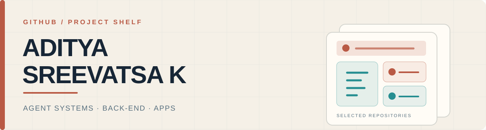
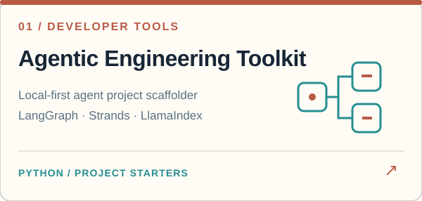
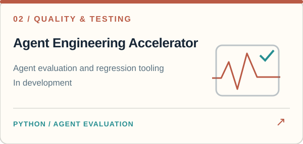
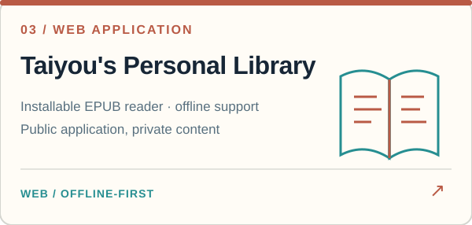
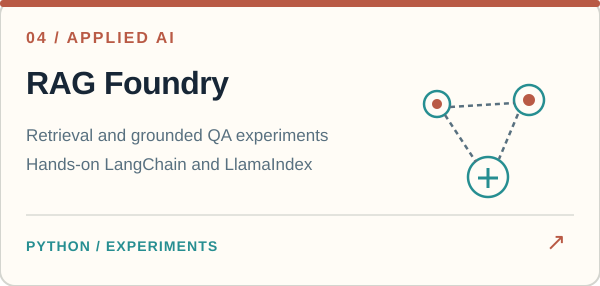

<picture><source media="(prefers-color-scheme: dark)" srcset="assets/shelf-hero-dark.svg"><source media="(prefers-color-scheme: light)" srcset="assets/shelf-hero-light.svg"></picture>

  <a href="#featured-code">Featured code</a> &nbsp;·&nbsp;
  <a href="#upstream-pull-requests">Open source</a> &nbsp;·&nbsp;
  <a href="#toolkit">Toolkit</a> &nbsp;·&nbsp;
  <a href="https://github.com/AdityaSreevatsaK?tab=repositories">All repositories</a>

## Featured code

<table>
<tr>
<td width="50%" valign="top"><a href="https://github.com/AdityaSreevatsaK/agentic-engineering-toolkit"><picture><source media="(prefers-color-scheme: dark)" srcset="assets/shelf-aet-dark.svg"><source media="(prefers-color-scheme: light)" srcset="assets/shelf-aet-light.svg"></picture></a></td>
<td width="50%" valign="top"><a href="https://github.com/AdityaSreevatsaK/agent-engineering-accelerator"><picture><source media="(prefers-color-scheme: dark)" srcset="assets/shelf-aea-dark.svg"><source media="(prefers-color-scheme: light)" srcset="assets/shelf-aea-light.svg"></picture></a></td>
</tr>
<tr>
<td width="50%" valign="top"><a href="https://github.com/AdityaSreevatsaK/Taiyous-Personal-Library"><picture><source media="(prefers-color-scheme: dark)" srcset="assets/shelf-reader-dark.svg"><source media="(prefers-color-scheme: light)" srcset="assets/shelf-reader-light.svg"></picture></a></td>
<td width="50%" valign="top"><a href="https://github.com/AdityaSreevatsaK/RAG-Foundry"><picture><source media="(prefers-color-scheme: dark)" srcset="assets/shelf-rag-dark.svg"><source media="(prefers-color-scheme: light)" srcset="assets/shelf-rag-light.svg"></picture></a></td>
</tr>
</table>

More code: [NLP Navigator](https://github.com/AdityaSreevatsaK/NLP-Navigator) · [PySpark Pipeline](https://github.com/AdityaSreevatsaK/PySpark-Pipeline) · [Neural Nexus](https://github.com/AdityaSreevatsaK/The-Neural-Nexus) · [all repositories](https://github.com/AdityaSreevatsaK?tab=repositories).

## Upstream pull requests

Selected contributions to external projects. Statuses refresh through a [repository GitHub Action](.github/workflows/profile-upstream.yml) after a design is approved for the default branch.

<!-- BEGIN:PROFILE_UPSTREAM -->
| Upstream project | Contribution | Status | Date (UTC) |
| :-- | :-- | :-- | :-- |
| rossjrw | [Recover stalled game states (#4934)](https://github.com/rossjrw/rossjrw/pull/4934) | **Merged** | 11 Nov 2026 |
| httpx2 | [Retry failed connection-pool closures (#1330)](https://github.com/pydantic/httpx2/pull/1330) | Open | 12 Nov 2026 |
| httpx2 | [Support an alternative authentication header (#1332)](https://github.com/pydantic/httpx2/pull/1332) | Open | 12 Nov 2026 |
| logfire | [Fix Windows CLI file locking (#2803)](https://github.com/pydantic/logfire/pull/2803) | Open | 12 Nov 2026 |
<!-- END:PROFILE_UPSTREAM -->

## Toolkit

**Agent systems** &nbsp; `Python` `LangGraph` `AWS Strands` `LlamaIndex` `LangChain` `RAG`

**Back-end & data** &nbsp; `FastAPI` `Java` `Spring Boot` `PostgreSQL` `Kafka` `PySpark`

**Build & delivery** &nbsp; `Docker` `GitHub Actions` `AWS` `Azure`

  <a href="https://www.linkedin.com/in/adityasreevatsak/">LinkedIn</a> ·
  <a href="mailto:krishnan.adityasreevatsa@gmail.com">Contact</a> ·
  <a href="https://github.com/AdityaSreevatsaK">GitHub</a>

