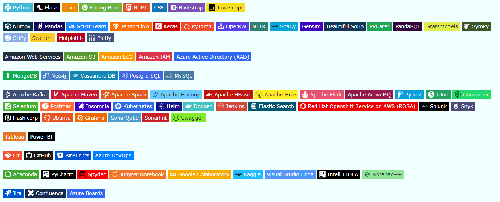

<h1 align="center">Aditya Sreevatsa K</h1>

  

---

## 🔭 Selected Engineering Projects

| Project | What it demonstrates |
| :-- | :-- |
| 🧩 [Agentic Engineering Toolkit](https://github.com/AdityaSreevatsaK/agentic-engineering-toolkit) | Local-first scaffolding for LangGraph, AWS Strands and LlamaIndex agents, with starter APIs and offline tests |
| 🧪 [Agent Engineering Accelerator](https://github.com/AdityaSreevatsaK/agent-engineering-accelerator) | Agent evaluation, regression checks and tracing; development candidate on the dev branch |
| 🔎 [RAG Foundry](https://github.com/AdityaSreevatsaK/RAG-Foundry) | Experimental text, PDF and conversational RAG using FAISS, LangChain and Ollama |
| 📚 [Taiyou's Personal Library](https://github.com/AdityaSreevatsaK/Taiyous-Personal-Library) | Offline-capable EPUB reader built with React, TypeScript and private Hugging Face storage |
| 🗂️ [Taiyou's Manga Library](https://github.com/AdityaSreevatsaK/Taiyous-Manga-Library) | Chapter-based manga reader with Cloudflare Pages, owner-only access and private media delivery |
| 🌸 [Taiyou's Shared Core & Hub](https://github.com/AdityaSreevatsaK/Taiyous-Shared-Core) | Responsive gateway to independently deployed readers and experimental shared UI contracts |
| 🛠️ [Novels Storage Controller](https://github.com/AdityaSreevatsaK/Taiyou-Novels-Storage-Controller) | Python tools for private novel imports, cover management, integrity checks and backups |
| ⚙️ [Manga Storage Controller](https://github.com/AdityaSreevatsaK/Taiyou-Manga-Storage-Controller) | Python tooling for verified manga imports, immutable media IDs and private catalogue management |
| 📊 [GitHub Actions Command Centre](https://github.com/AdityaSreevatsaK/github-actions-command-centre) | Read-only dashboard for exploring workflow runs across GitHub repositories |
| 📦 [Utility Shelf](https://github.com/AdityaSreevatsaK/Useful-Code-Snippets) | FastAPI-based collection of reusable Python utilities with a browsable web interface |

---

## 📌 Highlights

* 🎯 **AI engineering and solution architecture:** agentic workflows, tool orchestration, retrieval systems and Python APIs, with emphasis on reliable integration rather than model demos alone.
* 🧰 **Reusable developer tooling:** local-first agent project scaffolding, evaluation workflows, regression checks and CI that do not require paid inference.
* 🌐 **End-to-end product engineering:** browser applications, authentication boundaries, private storage integrations and independently deployed services.
* 🤝 **Open-source contributions:** fixes, tests and documentation in external Python projects, including [Wheelgap](https://github.com/wheelgap/wheelgap) and the [pytest ecosystem](https://github.com/pytest-dev). [Upstream pull requests](https://github.com/pulls?q=is%3Apr+author%3AAdityaSreevatsaK+is%3Apublic+-user%3AAdityaSreevatsaK).

---

## 🧠 Core Expertise

* **Agentic AI & LLM systems:** LangGraph, AWS Strands and LlamaIndex; tool use, multi-step workflows, RAG, conversational systems and provider integrations.
* **Backend engineering & APIs:** Python, FastAPI, data access patterns, authentication boundaries, configuration, service integration and maintainable application architecture.
* **Evaluation, reliability & security:** regression suites, offline test doubles, CI quality gates, observability with OpenTelemetry, failure handling and defensive defaults.
* **Applied ML & delivery:** PyTorch, scikit-learn and classical ML experimentation; data pipelines, Docker, cloud deployment and production-minded engineering practices.

---

## 🛠️ Tools & Technologies

---

## 🧪 Research & Innovation

* 📄 **Agent project scaffolding:** [AET](https://github.com/AdityaSreevatsaK/agentic-engineering-toolkit) generates mock-first starter projects across agent frameworks; production certification and multi-team adoption are not claimed.
* 🧪 **Agent evaluation:** [AEA](https://github.com/AdityaSreevatsaK/agent-engineering-accelerator/tree/dev) explores repeatable assessments, baselines and tracing for LangGraph and Strands. Its release candidate remains under development.
* 📈 **Applied AI prototypes:** [AlphaAgent](https://github.com/AdityaSreevatsaK/AlphaAgent) explores local financial-document retrieval and market data; [SmartFlow](https://github.com/AdityaSreevatsaK/SmartFlow) simulates bike-sharing redistribution using reinforcement learning.
* 🔧 **Engineering experiments:** local-first workflows, reusable components, secure private-data boundaries and ways to turn one-off prototypes into testable, maintainable systems.

---

## 📈 GitHub Stats

    <table>
        <tr>
            <td>
                
            </td>
            <td>
                
            </td>
        </tr>
    </table>

---

[//]: # (## 🌐 Find Me Here)
[//]: # ( )
[//]: # (
)
[//]: # (    <a href="https://adityasreevatsak-mle.netlify.app/" target="_blank">)
[//]: # (        <button style="background-color: #000; color: white; border: none; padding: 2px 2px; border-radius: 3px; display: flex; align-items: center; font-size: 12px;">)
[//]: # (            )
[//]: # (            Live Portfolio)
[//]: # (        </button>)
[//]: # (    </a>)
[//]: # (    <a href="https://www.linkedin.com/in/adityasreevatsak/">)
[//]: # (        )
[//]: # (    </a>)
[//]: # (    <a href="https://github.com/AdityaSreevatsaK">)
[//]: # (        )
[//]: # (    </a>)
[//]: # (
)
