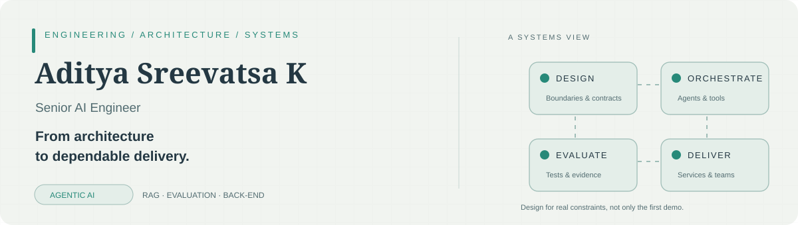

  <picture>
    <source media="(prefers-color-scheme: dark)" srcset="assets/studio-dark.svg">
    <source media="(prefers-color-scheme: light)" srcset="assets/studio-light.svg">
    
  </picture>

  <a href="https://github.com/AdityaSreevatsaK?tab=repositories">Repositories</a> ·
  <a href="https://www.linkedin.com/in/adityasreevatsak/">LinkedIn</a> ·
  <a href="mailto:krishnan.adityasreevatsa@gmail.com">Contact</a>

## Engineering dependable AI systems

I'm a **Senior AI Engineer** based in Bengaluru, specialising in enterprise **agentic AI**, **Retrieval-Augmented Generation (RAG)**, **natural-language-to-SQL**, **LLM evaluation**, and back-end services. My experience spans application engineering, ML platforms and client-facing technical delivery across multiple sectors.

I care about what happens *after* an AI demonstration works: architecture boundaries, testability, reliable service interfaces, observability and maintainability.

### Selected engineering work

| Project | Engineering focus | Explore |
| :-- | :-- | :-- |
| **Agentic Engineering Toolkit (AET)** | Local-first project scaffolding for Python agent applications. Templates across LangGraph, AWS Strands and LlamaIndex, with optional model providers and offline validation. | [Source and getting started](https://github.com/AdityaSreevatsaK/agentic-engineering-toolkit) |
| **Agent Engineering Accelerator (AEA)** | Work in progress on agent evaluation, regression analysis, testing and quality gates. Public documentation is being refreshed. | [Source and tests](https://github.com/AdityaSreevatsaK/agent-engineering-accelerator) |
| **RAG Foundry** | Experimental, hands-on retrieval patterns and grounded question-answering implementations. | [Explore experiments](https://github.com/AdityaSreevatsaK/RAG-Foundry) |

### Behind the architecture

**Separation of responsibilities.** I keep project setup and agent quality evaluation as distinct concerns. AET supplies the starter foundations; AEA explores the evaluation lifecycle. That separation is intended to help teams adopt either capability without coupling them unnecessarily.

**Portable foundations, with explicit limits.** AET offers offline mock workflows and opt-in provider integrations. Its documentation distinguishes synthetic tests from live model validation and does not claim production readiness or proven cross-team adoption.

**Evidence before confidence.** I value regression tests, clear failure boundaries, reproducible checks and documentation that states both what has been demonstrated and what remains unverified.

For implementation detail, see [AET's engineering deep dive](https://github.com/AdityaSreevatsaK/agentic-engineering-toolkit/blob/master/PROJECT_DEEP_DIVE.md).

### Professional engineering experience

- **Senior AI Engineer (Dec 2025 to present):** Agentic analytics, orchestration, Text-to-SQL, evaluation, API design and technical delivery with cross-functional teams.
- **Infosys · Associate Consultant (Apr 2024 to Dec 2025):** Enterprise ML, natural-language graph queries, Neo4j, service and API engineering.
- **Ernst & Young · Software Engineer (Dec 2023 to Mar 2024):** Fraud analytics, Kafka-based data processing and ML pipelines.
- **Accenture · Software Engineering Analyst (Dec 2021 to Dec 2023):** Enterprise back-end services, Java/Python microservices and delivery quality.

*Professional work is described at a non-confidential level. Client architecture and project-specific performance claims are deliberately omitted.*

### Selected open-source contributions

- [rossjrw #4934](https://github.com/rossjrw/rossjrw/pull/4934): improved recovery from unplayable game states (merged).
- [HTTPX2 #1330](https://github.com/pydantic/httpx2/pull/1330): retry behaviour for failed stream closures.
- [HTTPX2 #1332](https://github.com/pydantic/httpx2/pull/1332): DigestAuth challenge header compatibility.

### Technical focus

**AI orchestration:** LangGraph, AWS Strands, LangChain, LlamaIndex, RAG, Text-to-SQL and LLM evaluation  
**Engineering:** Python, Java, FastAPI, Spring Boot, REST APIs, CI/CD, Docker and Kubernetes  
**Data and cloud:** PostgreSQL, Neo4j, Pinecone, Apache Kafka, AWS and Azure

<strong>Education, awards and earlier projects</strong>

- **M.Tech, Data Science, Machine Learning & AI**, PES University (2026), GPA **9.9/10**, first in cohort.
- **B.E., Mechanical Engineering**, CMR Institute of Technology (2021), GPA **8.6/10**.
- Recognised through Infosys Gracias Awards, EY User Appreciation and Accenture ACE Award.
- Additional repositories: [NLP Navigator](https://github.com/AdityaSreevatsaK/NLP-Navigator), [PySpark Pipeline](https://github.com/AdityaSreevatsaK/PySpark-Pipeline), [The Neural Nexus](https://github.com/AdityaSreevatsaK/The-Neural-Nexus).

---

Architecture • Evidence • Delivery · Curated profile prototype, not an automated status dashboard

