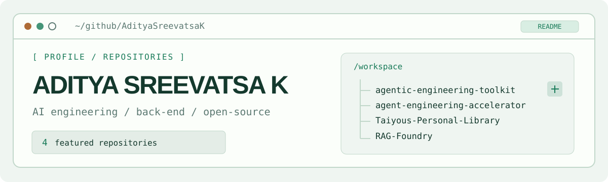
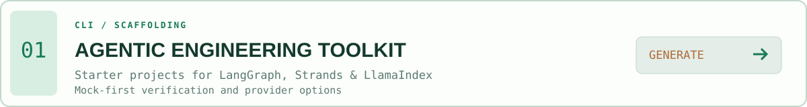
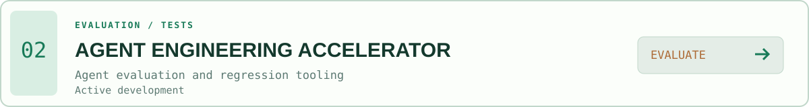
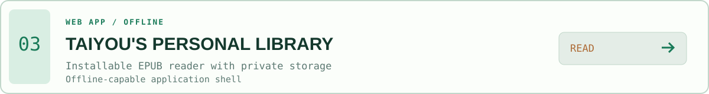
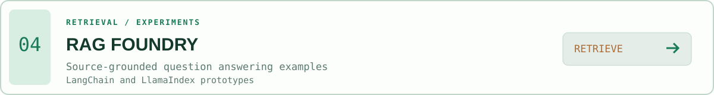

<div align="center">
<picture><source media="(prefers-color-scheme: dark)" srcset="assets/workspace-hero-dark.svg"><source media="(prefers-color-scheme: light)" srcset="assets/workspace-hero-light.svg"></picture>
</div>

<p align="center">
  <a href="#repositories">Repositories</a> ·
  <a href="#upstream-work">Upstream work</a> ·
  <a href="#stack">Stack</a> ·
  <a href="https://github.com/AdityaSreevatsaK?tab=repositories">Explore all</a>
</p>

## Repositories

<a href="https://github.com/AdityaSreevatsaK/agentic-engineering-toolkit"><picture><source media="(prefers-color-scheme: dark)" srcset="assets/workspace-aet-dark.svg"><source media="(prefers-color-scheme: light)" srcset="assets/workspace-aet-light.svg"></picture></a>

<a href="https://github.com/AdityaSreevatsaK/agent-engineering-accelerator"><picture><source media="(prefers-color-scheme: dark)" srcset="assets/workspace-aea-dark.svg"><source media="(prefers-color-scheme: light)" srcset="assets/workspace-aea-light.svg"></picture></a>

<a href="https://github.com/AdityaSreevatsaK/Taiyous-Personal-Library"><picture><source media="(prefers-color-scheme: dark)" srcset="assets/workspace-library-dark.svg"><source media="(prefers-color-scheme: light)" srcset="assets/workspace-library-light.svg"></picture></a>

<a href="https://github.com/AdityaSreevatsaK/RAG-Foundry"><picture><source media="(prefers-color-scheme: dark)" srcset="assets/workspace-rag-dark.svg"><source media="(prefers-color-scheme: light)" srcset="assets/workspace-rag-light.svg"></picture></a>

<sub>Additional repositories: [NLP Navigator](https://github.com/AdityaSreevatsaK/NLP-Navigator) / [PySpark Pipeline](https://github.com/AdityaSreevatsaK/PySpark-Pipeline) / [The Neural Nexus](https://github.com/AdityaSreevatsaK/The-Neural-Nexus)</sub>

## Upstream work

Automatically discovers public upstream PRs and refreshes their status through [GitHub Actions](.github/workflows/profile-upstream.yml) when the design is published on the default branch.

<!-- BEGIN:PROFILE_UPSTREAM -->
**Open upstream PRs: 6** · **Merged: 1** · [View all upstream PRs](https://github.com/pulls?q=is%3Apr+author%3AAdityaSreevatsaK+-user%3AAdityaSreevatsaK)

| Repository | Contribution | Status | Last activity (UTC) |
| :-- | :-- | :-- | :-- |
| pytest-dev/pytest-cov | [Fix coverage merging for custom file tracers (#775)](https://github.com/pytest-dev/pytest-cov/pull/775) | Open | 13 Nov 2026 |
| pydantic/httpx2 | [Support larger SSE events (#1333)](https://github.com/pydantic/httpx2/pull/1333) | Open | 13 Nov 2026 |
| pydantic/httpx2 | [Fix HTTP/2 response stalls (#1334)](https://github.com/pydantic/httpx2/pull/1334) | Open | 13 Nov 2026 |
| pydantic/logfire | [Fix Windows log-clean file locking (#2803)](https://github.com/pydantic/logfire/pull/2803) | Open | 12 Nov 2026 |
| pydantic/httpx2 | [Support an alternative authentication header (#1332)](https://github.com/pydantic/httpx2/pull/1332) | Open | 12 Nov 2026 |
| pydantic/httpx2 | [Retry failed pool stream closures (#1330)](https://github.com/pydantic/httpx2/pull/1330) | Open | 12 Nov 2026 |
| rossjrw/rossjrw | [Recover stalled game states (#4934)](https://github.com/rossjrw/rossjrw/pull/4934) | **Merged** | 11 Nov 2026 |
<!-- END:PROFILE_UPSTREAM -->

## Stack

```text
AI + agents    Python · LangGraph · Strands · LlamaIndex · LangChain · PyTorch
Services       FastAPI · Java · Spring Boot · SQL · PostgreSQL
Data           Kafka · PySpark · Neo4j · Pinecone
Infrastructure Docker · GitHub Actions · AWS · Azure
```

<div align="center">
  <a href="https://github.com/AdityaSreevatsaK?tab=repositories">ALL REPOSITORIES</a> &nbsp; · &nbsp;
  <a href="https://www.linkedin.com/in/adityasreevatsak/">LINKEDIN</a> &nbsp; · &nbsp;
  <a href="mailto:krishnan.adityasreevatsa@gmail.com">CONTACT</a>
</div>
