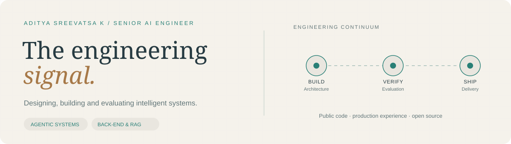

  <picture>
    <source media="(prefers-color-scheme: dark)" srcset="assets/signal-dark.svg">
    <source media="(prefers-color-scheme: light)" srcset="assets/signal-light.svg">
    
  </picture>

  <a href="#projects">Projects</a> ·
  <a href="#open-source">Open source</a> ·
  <a href="#technologies">Technologies</a> ·
  <a href="https://www.linkedin.com/in/adityasreevatsak/">LinkedIn</a>

## Hi, I'm Aditya 👋

I'm a **Senior AI Engineer** working on agentic AI, RAG, LLM evaluation and back-end systems. I like building useful software, particularly tools that make AI development easier to start, test and maintain.

### Projects

| Project | What you'll find |
| :-- | :-- |
| **[Agentic Engineering Toolkit (AET)](https://github.com/AdityaSreevatsaK/agentic-engineering-toolkit)** | A local-first CLI for scaffolding LangGraph, AWS Strands and LlamaIndex applications. Includes mock-powered tests and optional model providers. [Architecture notes](https://github.com/AdityaSreevatsaK/agentic-engineering-toolkit/blob/master/PROJECT_DEEP_DIVE.md). |
| **[Agent Engineering Accelerator (AEA)](https://github.com/AdityaSreevatsaK/agent-engineering-accelerator)** | Work in progress: evaluation, regression testing and quality checks for AI agents. |
| **[Taiyou's Personal Library](https://github.com/AdityaSreevatsaK/Taiyous-Personal-Library)** | A responsive web reader with authentication, offline reading and private content storage. |
| **[RAG Foundry](https://github.com/AdityaSreevatsaK/RAG-Foundry)** | Practical RAG experiments covering retrieval, orchestration and grounded question answering. |

Also exploring [NLP](https://github.com/AdityaSreevatsaK/NLP-Navigator), [PySpark](https://github.com/AdityaSreevatsaK/PySpark-Pipeline) and [deep learning](https://github.com/AdityaSreevatsaK/The-Neural-Nexus).

### Open source

Selected pull requests to projects outside my own repositories. Their statuses are checked by a [GitHub Action](.github/workflows/profile-upstream.yml) every 12 hours when this profile is on the default branch.

<!-- BEGIN:PROFILE_UPSTREAM -->
| Upstream project | Contribution | Status | Date (UTC) |
| :-- | :-- | :-- | :-- |
| rossjrw | [Recover stalled game states (#4934)](https://github.com/rossjrw/rossjrw/pull/4934) | **Merged** | 11 Nov 2026 |
| httpx2 | [Retry failed connection-pool closures (#1330)](https://github.com/pydantic/httpx2/pull/1330) | Open | 12 Nov 2026 |
| httpx2 | [Support an alternative authentication header (#1332)](https://github.com/pydantic/httpx2/pull/1332) | Open | 12 Nov 2026 |
| logfire | [Fix Windows CLI file locking (#2803)](https://github.com/pydantic/logfire/pull/2803) | Open | 12 Nov 2026 |
<!-- END:PROFILE_UPSTREAM -->

### Technologies

**AI & agents** · `Python` `LangGraph` `AWS Strands` `LlamaIndex` `LangChain` `PyTorch`

**Back-end & data** · `FastAPI` `Java` `Spring Boot` `PostgreSQL` `Kafka` `PySpark`

**Tooling & platforms** · `Docker` `GitHub Actions` `AWS` `Azure` `Git`

---

  <a href="https://github.com/AdityaSreevatsaK?tab=repositories">All repositories</a> ·
  <a href="https://www.linkedin.com/in/adityasreevatsak/">LinkedIn</a> ·
  <a href="mailto:krishnan.adityasreevatsa@gmail.com">Email</a>

